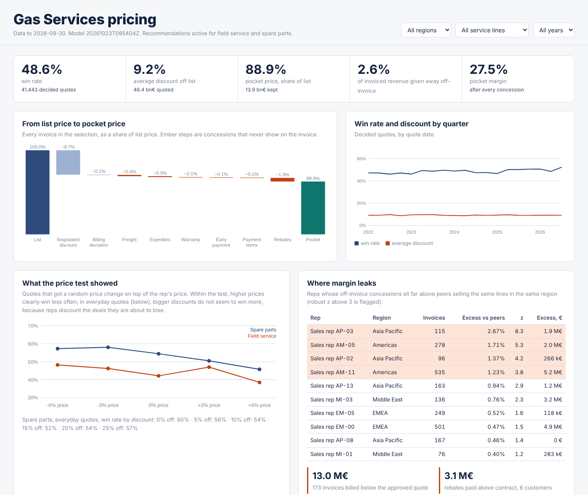

# B2B pricing intelligence

**Data-driven pricing for an industrial service business: a governed warehouse built from CRM, CPQ,
ERP and market data, win-probability and price-response models, price recommendations inside
guardrails, a margin-leakage analysis, a bookings forecast, a pricing dashboard, a Power BI star
schema, and an analytics assistant that answers questions without ever leaving its permissions.**

The setting is the service business around gas turbines, steam turbines and generators: spare parts,
field service, repairs, upgrades and long-term service agreements, sold by 60 reps in four regions.
The sources are simulated (real quote and invoice data is confidential and cannot show what a
different price would have earned), and the simulation keeps the truth, so every number below is
measured against a known answer ([why](docs/adr/0004-simulated-sources.md)).



## What it found

| | Result |
|---|---|
| **Price sensitivity read from history is wrong** | Reps give bigger discounts on deals they sense are at risk, so in history low prices travel with lost deals. A model with every recorded control still put the effect of a 5% price rise at -2.3 points for spare parts (true -5.5) and got the sign wrong for repairs, upgrades and service agreements. The randomised price test measured -4.8 for spare parts. |
| **Recommendations earn more where the price response is validated** | On 9,149 test-period quotes in spare parts and field service, recommended prices raise true expected margin by **4.0%** (95% interval 3.8% to 4.2%), €10.5M over 15 months, at -0.5 points of win rate and **0 guardrail violations**. The best possible within the same guardrails is 5.3%. Prices set from history-based sensitivity would have cost 8.9 points of win rate on the same lines. |
| **The case for the next price tests** | Repairs and upgrades keep the reps' prices because nothing validated their sensitivity. If tested, the same method is worth +5.7% and +11.6% expected margin there. |
| **Margin leakage** | 4 of 5 reps who give away freight, expedites and payment terms flagged against peers, no false flags (€9.4M above peers); 173 of 173 invoices billed below the approved quote (€13.0M); 6 of 6 customers paid rebates above contract. |
| **Bookings forecast** | 15.4% WAPE one to three months ahead, against 19.0% for last year's same month and 155% for the CRM-weighted pipeline, whose stale close dates pile up in the current month. 80% intervals held 80% of outcomes. |
| **Data quality** | 487 of 487 planted defects held by the data contracts (bad currencies, prices, dates, missing reps, CRM re-sends, an interface that sent cents for two weeks, rebates on unknown customers); 0 of 346,481 good rows held by mistake; 52 dbt tests. |
| **Assistant** | 100% on curated questions; **82.5%** on 40 held-out questions written from the semantic model by someone without access to the parser. The held-out set's first run caught one policy failure (a request to change data was answered with a read); such requests are now refused, and no question across the 112 gets an answer outside the asker's region or role. |

Full results: [reports/EVALUATION.md](reports/EVALUATION.md). CI regenerates them on every push and
`bpi gate` fails the build when an objective in [config/objectives.yaml](config/objectives.yaml) is
missed.

## How it works

```
CRM, CPQ, ERP, market data, FX
   -> data contracts (contracts/*.yaml): typed, owned, referenced; bad rows held with the reason
   -> dbt (warehouse/): staging -> intermediate -> marts, DuckDB locally, Snowflake target included
   -> models: win probability, price-test slopes, recommender, leakage, forecast  -> registry
   -> FastAPI for the CPQ/CRM, dashboard, Power BI star schema, governed assistant
```

- **Warehouse.** dbt models in portable SQL (DuckDB and Snowflake share `qualify`, `median`,
  `date_trunc`; the one difference is an adapter-dispatched macro). Marts: quotes with point-in-time
  features, the price waterfall from list to pocket price, billing exceptions, rebate reconciliation,
  monthly bookings, pipeline snapshots. Tests include "the waterfall reconciles to the cent" and "no
  feature looks past the quote date".
- **Win probability.** Logistic regression (the readable model won) against LightGBM forced to be
  monotone in price and a segment-rate baseline; calibration error 0.016 on later quotes.
- **Price response.** Only from the randomised price test, with the win model's prediction at the
  rep's own price as an offset; a line drives recommendations only when its slopes are precise enough
  ([ADR 0001](docs/adr/0001-price-response-from-experiments.md)).
- **Recommendations.** Expected-margin optimisation per quote inside guardrails owned by Global
  Pricing Strategy ([config/pricing.yaml](config/pricing.yaml)): margin floor per line, at most 10%
  from the rep's price, never above list, long-term agreements to the deal desk. Each answer comes
  with a range, the win probabilities and the reasons, and is written to an audit log.
- **Leakage.** Reps against peers selling the same lines in the same region (robust z-score with a
  materiality floor), invoices below the approved quote, rebates against contract.
- **Forecast.** Holt-Winters, the pipeline weighted by stage shares learned from earlier snapshots,
  and their blend; champion per line picked on validation months, scored on later months.
- **Assistant.** A question becomes a query specification over a semantic model written in
  [Snowflake's semantic view YAML](semantic/pricing_semantic_view.yaml) shape (so it can back Cortex
  Analyst); the [access policy](semantic/access_policy.yaml) limits sales roles to their region and
  keeps cost-based margins from reps; SQL is generated only from the model's definitions; requests
  to change data are refused. A deterministic parser runs in CI; a Claude tool-use parser is optional
  and produces the same specification ([ADR 0003](docs/adr/0003-governed-assistant.md)).
- **Dashboard and Power BI.** [reports/dashboard.html](reports/dashboard.html) opens without a server
  and filters by region, line and year. `bpi export-powerbi` writes the star schema as Parquet with
  the DAX measures, defined like the semantic model.
- **Handover.** `bpi handover-check` verifies what an internal team needs to own the solution
  without its authors: a contract and an owner per source, model cards, a registered and evaluated
  version, runbook, code owners, no secrets. [docs/HANDOVER.md](docs/HANDOVER.md) is the process for
  taking over a solution an outside partner built: inventory, reproduce, parallel run, acceptance,
  cutover.

## Run it

```bash
pip install -e ".[dev]"
bpi run                       # generate, ingest, dbt build, train, evaluate, export, gate (about 40 s)
bpi ask "top 5 reps by leakage rate last year" --role regional_manager --region EMEA
bpi handover-check
pytest -q

export BPI_API_KEYS='{"dev-key": {"role": "pricing_analyst"}}'
bpi serve
curl -H "Authorization: Bearer dev-key" localhost:8000/v1/quotes/Q042425/recommendation
curl -H "Authorization: Bearer dev-key" -H "content-type: application/json" \
  -d '[{"customer_id": "C0001", "product_id": "P1000-INSP", "proposed_net_price_eur": 120000, "competitor_present": true}]' \
  localhost:8000/v1/price-recommendations
```

Docker: `docker build -t bpi .` then `docker run -v $PWD/home:/data bpi bpi run` and
`docker run -p 8000:8000 -v $PWD/home:/data -e BPI_API_KEYS=... bpi`.

## Layout

```
contracts/            one data contract per source: owner, key, typed columns, rules, references
warehouse/            dbt project: staging, intermediate, marts, tests, cross-database macros
semantic/             semantic model (Snowflake semantic view shape) and access policy
config/               pricing guardrails, thresholds, release objectives (owned by pricing)
src/bpi/
  synth/world.py      the simulated business and its truth
  contracts.py        ingest with quarantine
  models/             win probability, price response, recommendations, leakage, forecast
  assistant/          parser, Claude parser, semantic layer and policy, evaluation
  api.py              HTTP API with roles, regions and an audit log
  evaluate.py         grading against the truth, figures, release gate
  dashboard.py        reports/dashboard.html
  powerbi.py          star schema and DAX measures
  handover.py         handover readiness check
docs/                 architecture, ADRs, model cards, runbook, handover process
tests/                unit tests, pipeline tests, assistant question sets
```

## Limits

- **Simulated data.** The results show how the methods behave when the simulation's assumptions hold
  (a confounded pricing process, a randomised test, planted leakage). On real data the truth-based
  sections of the evaluation are replaced by backtests and by the next price test.
- **Snowflake, Power BI and UiPath are not exercised.** The dbt project has a Snowflake target and the
  semantic model follows the semantic view format, but neither has run against an account; the Power
  BI export has not been opened in Power BI Desktop in CI; there is no RPA component.
- **Price tests.** The no-competitor slopes are imprecise (spare parts 95% interval -4.7 to +1.2), the
  field service test is small, and three lines have no test at all.
- **The assistant's parser** answers wrongly on about one in five unseen phrasings (it refuses or
  answers a narrower question). No answer has crossed a region or role restriction. The Claude parser is
  tested with a stub, not against the live API.
