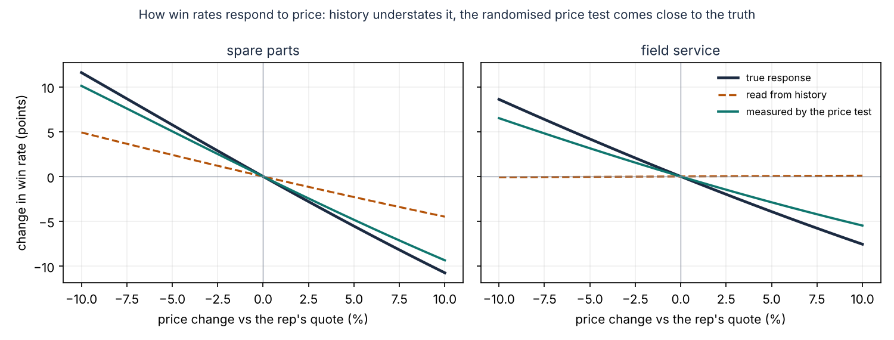
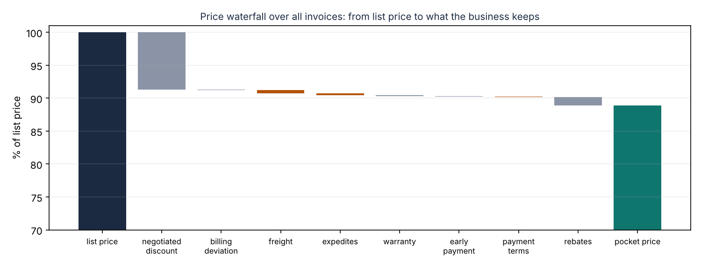
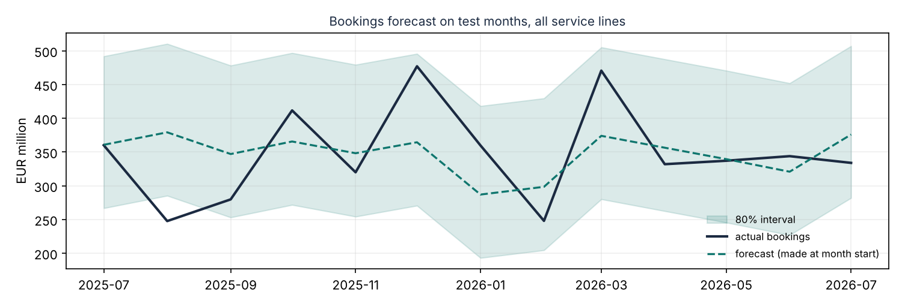

# Evaluation

Model version `20261023T100432Z`, data to 2026-09-30. Everything below is measured against the simulation's truth, which the pipeline itself never reads. Regenerate with `bpi run`.

## Data layer

- Planted defects caught by the data contracts: **487 of 487** (100.0%).
- Good rows wrongly quarantined: **0 of 346,481**. Rows held only because their parent was held: 198.
- dbt tests: 52 run, 0 failed.

| Defect | Caught |
|---|---|
| amount in cents | 73 of 73 |
| bad currency | 40 of 40 |
| duplicate row | 250 of 250 |
| future date | 40 of 40 |
| missing rep | 40 of 40 |
| non positive price | 40 of 40 |
| unknown customer | 4 of 4 |

## Win probability

11,448 quotes issued after the training window. Champion: **logistic** (chosen on the last six months of training data).

| Model | Log loss | Brier | AUC | Calibration error |
|---|---|---|---|---|
| segment_rate | 0.6835 | 0.2453 | 0.5734 | 0.02 |
| logistic | 0.6598 | 0.2338 | 0.6446 | 0.0161 |
| gbm | 0.6623 | 0.235 | 0.6385 | 0.015 |
| gbm_unconstrained | 0.6622 | 0.235 | 0.6387 | 0.0132 |
| oracle (true probabilities) | 0.6243 | 0.2177 | 0.7054 | 0.0102 |

## Price sensitivity

Change in win rate if every quote in the test period were priced 5% higher. History-based estimates come from models that see everything recorded; the price-test estimate uses only the randomised quotes.

| Service line | True | Read from history (logistic) | Read from history (GBM) | Price test |
|---|---|---|---|---|
| spare parts | -5.5 pts | -2.3 pts | -1.2 pts | -4.8 pts |
| field service | -3.9 pts | +0.0 pts | -0.5 pts | -2.9 pts |
| repairs | -3.3 pts | +3.2 pts | -0.3 pts | no test |
| upgrades | -2.1 pts | +2.6 pts | -0.2 pts | no test |
| LTSA | -1.7 pts | +4.0 pts | -0.2 pts | no test |

Slopes (change in log-odds of winning per unit of log price):

| Service line | True, no / with competitor | History | Price test (95% CI) |
|---|---|---|---|
| spare parts | -4.0 / -6.0 | -1.1 / -2.65 | -1.74 (-4.7 to 1.22) / -6.01 (-8.5 to -3.53); 2,536 quotes; validated |
| field service | -3.0 / -4.5 | 0.76 / -0.79 | -0.41 (-4.65 to 3.84) / -5.02 (-9.58 to -0.46); 995 quotes; validated |
| repairs | -2.5 / -3.75 | 3.66 / 2.11 | no test |
| upgrades | -2.0 / -3.0 | 3.02 / 1.47 | no test |
| LTSA | -1.5 / -2.25 | 4.02 / 2.47 | no test |



## Price recommendations

Each policy re-prices the 11,448 test quotes inside the guardrails (margin floor, at most 10% from the rep's price, never above list, LTSA to the deal desk). Margin is the true expected margin, P(win) x (price - cost), compared with the reps' own prices.

| Policy | Margin, validated lines | Margin, all lines | Win rate, validated lines | Avg price change | Guardrail violations |
|---|---|---|---|---|---|
| production (price-test slopes, validated lines only) | 4.00% | 0.93% | -0.5 pts | 1.6% | 0 |
| observational slopes on every line | 0.33% | 3.57% | -8.9 pts | 8.7% | 0 |
| oracle on validated lines (best possible) | 5.29% | 1.23% | +0.2 pts | 1.0% | 0 |
| oracle on every line (if every line had a test) | 5.29% | 4.81% | +0.2 pts | 2.0% | 0 |

Production policy: expected margin 4.00% on validated lines (95% bootstrap interval 3.84% to 4.16%), €10.5M over the test period. Status of test quotes: recommended 9,149, hold unvalidated 2,082, deal desk 217.

By service line (production policy / oracle on every line):

| Service line | Production | If every line had a price test (oracle) | Observational slopes |
|---|---|---|---|
| spare parts | 3.2% margin, +0.2 pts win | 4.7%, +1.6 pts | -1.7%, -9.9 pts |
| field service | 6.2% margin, -2.4 pts win | 7.0%, -3.4 pts | 5.9%, -6.4 pts |
| repairs | 0.0% margin, +0.0 pts win | 5.7%, -2.6 pts | 4.7%, -5.4 pts |
| upgrades | 0.0% margin, +0.0 pts win | 11.6%, -3.6 pts | 11.5%, -3.8 pts |
| LTSA | 0.0% margin, +0.0 pts win | 0.0%, +0.0 pts | 0.0%, +0.0 pts |

## Margin leakage

| Finding | Found | Planted | Precision | Recall | Amount found |
|---|---|---|---|---|---|
| Reps with excess off-invoice concessions | 4 | 5 | 1.0 | 0.8 | €9.4M above peers |
| Invoices billed below the approved quote | 173 | 173 | 1.0 | 1.0 | €13.0M |
| Customers paid rebates above contract | 6 | 6 | 1.0 | 1.0 | €3.1M of €3.9M planted |

Rebate years left out because invoices were held by the data contracts: 56.



## Bookings forecast

Champion per service line chosen on origins 2024-01-01 to 2025-04-01; scored on origins 2025-07-01 to 2026-07-01, one to three months ahead.

| Model | WAPE, all lines | Bias |
|---|---|---|
| seasonal_naive | 19.0% | -7.4% |
| ets | 16.8% | -2.1% |
| pipeline_crm | 155.1% | 152.1% |
| pipeline_learned | 16.4% | 0.5% |
| blend | 15.5% | -0.8% |
| **champions** | **15.4%** | |

| Service line | Champion | WAPE | vs last year's month | vs CRM pipeline | 80% interval coverage |
|---|---|---|---|---|---|
| field service | blend | 13.2% | 22.7% | 39.1% | 64% |
| LTSA | blend | 25.2% | 27.6% | 193.7% | 67% |
| repairs | pipeline_learned | 10.9% | 25.4% | 61.9% | 92% |
| spare parts | ets | 6.9% | 13.5% | 13.7% | 95% |
| upgrades | blend | 15.6% | 34.4% | 175.6% | 85% |

Interval coverage over all lines: 80% (target 80%).



## Assistant

| Question set | Questions | Correct answers | Correct refusals | Policy violations |
|---|---|---|---|---|
| curated (written with the parser) | 42 | 100% | 100% | 0 |
| held-out v1, now regression (first run 25 of 30) | 30 | 100% | 100% | 0 |
| held-out v2 (never used to change the parser; first run 32 of 40 with 1 violation, see below) | 40 | 78% | 100% | 0 |

Held-out questions answered wrongly (kept as they are; fixing them retires this set):

- emea win rate 2025 (refused: I could not find a measure in the question)
- What was the margin on our quotes to oil & gas customers in March 2026? (answered a different question)
- who are my top 3 account managers by order intake since 2025? (answered a different question)
- Can you show me the discount level by customer segment for upgrades quoted in the first half of 2025? (answered a different question)
- revenue utility vs ipp 2025 (answered a different question)
- win rate by service line for urgent vs non-urgent jobs in 2025 (answered a different question)
- which 10 reps gave the deepest discounts to oil and gas customers over the last 18 months? (refused: I could not find a measure in the question)

## Monitoring (latest quarter vs training)

Calibration error on recent decisions: 0.017. Alerts: none.

| Feature | PSI |
|---|---|
| log_ratio | 0.0086 |
| log_list_eur | 0.0238 |
| competitor_present | 0.0001 |
| outage_urgent | 0.0001 |
| prior_win_rate | 0.1061 |
| log_competitor_index | 0.1829 |
| service_line | 0.0028 |
| product_family | 0.0081 |
| region | 0.0024 |
| segment | 0.0022 |
| unit_type | 0.0008 |

## Release gate

```
PASS  data_quality_planted_defects_caught: 1.0 (target >= 0.99)
PASS  data_quality_false_quarantine_rate: 0.0 (target <= 0.001)
PASS  win_model_log_loss_vs_segment_rate: -0.0237 (target <= -0.02)
PASS  win_model_ece: 0.0161 (target <= 0.03)
PASS  experiment_effect_error_spare_parts: 0.007 (target <= 0.02)
PASS  recommendation_margin_uplift_validated_lines: 0.04 (target >= 0.01)
PASS  recommendation_uplift_ci_low: 0.0384 (target > 0.0)
PASS  recommendation_win_rate_change: -0.005 (target >= -0.03)
PASS  guardrail_violations: 0 (target <= 0)
PASS  leakage_rep_precision: 1.0 (target >= 0.8)
PASS  leakage_rep_recall: 0.8 (target >= 0.8)
PASS  billing_exceptions_recall: 1.0 (target >= 0.95)
PASS  rebate_overpayment_precision: 1.0 (target >= 0.99)
PASS  forecast_wape_vs_seasonal_naive: -0.036 (target < 0.0)
PASS  forecast_interval_coverage: 0.805 (target >= 0.7)
PASS  assistant_answer_accuracy: 1.0 (target >= 0.95)
PASS  assistant_heldout_accuracy: 0.825 (target >= 0.75)
PASS  assistant_policy_violations: 0 (target <= 0)
```
